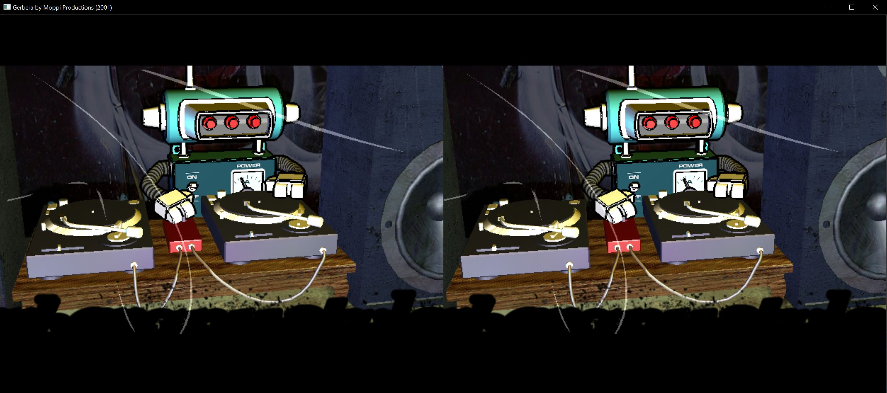

# DeepScene

### Classic 3D demos, now with depth

**Step inside the demoscene.** DeepScene plays old 3D demos in stereo, live, in your VR headset or in a window. 
Pick a demo, press **Launch**, and enjoy the show.

## [⬇️ Download the latest release](https://github.com/kbiElude/DeepScene/releases/download/v1.0.0/DeepScene-v1.0.0-windows.zip)

Your VR headset needs to support OpenXR. Tested with the Meta Quest 3.

---

## License

MIT; see [LICENSE.txt](LICENSE.txt).

---

A spare-time project by Dominik Witczak, built with help from the Sonnet AI model.
